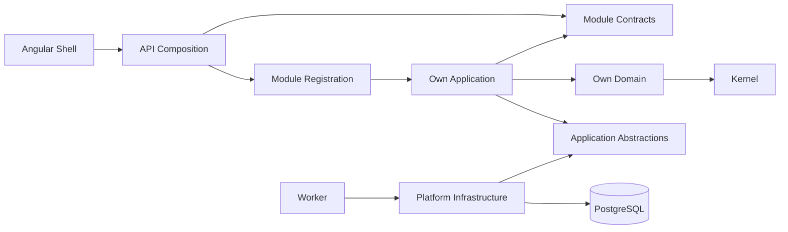

# Foundation architecture and dependency rules

Modular Monolith واحد بأدوار تشغيل API وWorker، وMigration runner منفصل. توجد Skeleton assemblies لكل من
Inventory/Sales/Procurement/Manufacturing/Workflow/Localization. Finance تنفذ شريحة القيد اليدوي فقط بأربع طبقات مستقلة.
Platform يحتفظ بplumbing مشتركة لـscope/UoW/Audit/Idempotency/Outbox/Inbox، وبملكية schemas `audit` و`integration` فقط.

لكل business module أربع assemblies: Domain وContracts وApplication وInfrastructure.

- Domain/Contracts تعتمد على Kernel فقط؛ لا EF/Npgsql/HTTP/Domain graph في Contracts.
- Application تعتمد على Domain/Contracts الخاصين بها وApplication abstractions.
- Sales.Application يمكن أن تعتمد على Finance.Contracts وInventory.Contracts فقط من هذين المجالين.
- Infrastructure تعتمد على implementation الخاصة بالوحدة. يسمح لها باستعمال Platform.Infrastructure كـshared UoW adapter،
  ولا يسمح بذلك للوصول إلى persistence لأي business module آخر.
- API/Worker composition roots تسجل adapters. لا SQL أو SaveChanges أو accounting logic في hosts.
- Web يتصل بعقود HTTP؛ لا database SDK أو اتصال DB في UI.
- Kernel لا يحوي business aggregates أو قواعد costing/tax أو generic repositories.

تفرض [Architecture tests](../tests/Erp.ArchitectureTests/DependencyTests.cs) قواعد المراجع، الحزم المحظورة،
compiled assembly references، cycles، وغياب DB access في Web/hosts. تتضمن أمثلة injected violations ترفضها نفس القواعد.
static rules لا تبرهن ملكية SQL runtime وحدها؛ مراجعة adapters وRLS وintegration tests تكملها.

`IApplicationTransaction` لا يكشف EF إلى Application/Contracts. Infrastructure adapters تُلحق DbContexts الخاصة بها
باتصال ومعاملة `PostgresTransaction` نفسها؛ لا contexts متوازية على الاتصال ولا SaveChanges مستقلة تثبت جزءًا.
تُحفظ audit/outbox/receipt مع الأثر المحلي. External dispatch بعد commit؛ لا broker مستقل ولا exactly-once claim.

Scope: authenticated adapter → current ERP membership → tenant/company selectors verified → immutable VerifiedContext
→ transaction-local PostgreSQL settings. Header/body tenant ليس authority. Worker يملك منحًا محددة من server configuration
ويستخدم المسار نفسه؛ لا BYPASSRLS credentials.

Finance.Domain تملك JournalEntry/JournalLine وحالتي Draft/Posted وقواعد الأموال والاتزان. Finance.Application تملك
Create/Update/Validate/Post commands وports للجلسة والاستعلامات. Finance.Infrastructure تملك HTTP delivery وEF mappings
وschema `finance` وmigration مستقلة. Application لا ترى EF أوNpgsql أوHTTP. Audit تقرأ عبر port يملكه Platform.
`ScopeAction` metadata مشتركة في Platform delivery؛ لا dependency من Finance إلى API host.

كل قيد مرحّل مع سطوره هو حقيقة دفتر الأستاذ لهذه الشريحة؛ لا نسخة مالية ثانية قابلة للتعديل. Audit/Outbox/receipt تنضم
إلى المعاملة المحلية نفسها. مستهلك `finance.posted-trace.v1` يسجل دليل تسليم فقط عبر Inbox؛ لا ينشئ أثرًا ماليًا آخر.
تفاصيل ترتيب الأقفال وعقود العمليات في [Manual Journal](MANUAL-JOURNAL-V1.md).

TrialBalanceQuery هي قراءة مخصصة في Finance.Application. Adapter PostgreSQL يجمع الأرقام على الخادم ولا يحمل القيود
إلى الذاكرة. معاملة Repeatable Read/Read Only مستقلة عن UoW الكتابة تنفذ التجميع والضوابط المستقلة في لقطة واحدة،
وتستخدم إعدادات scope المحلية نفسها. لا يستدعي التقرير writers أوAudit أوOutbox. الأرصدة مشتقة من Posted ledger فقط؛
لا جدول balances أوprojection جديدة. [عقود التقرير ومعادلاته](TRIAL-BALANCE-V1.md) تحدد نطاق افتتاحي عمر الدفتر.

General Ledger Detail is a Finance Application query/reader port with a Finance Npgsql adapter. It uses REPEATABLE READ + READ ONLY, transaction-local verified scope, exact SQL windows before pagination and independent same-snapshot Trial Balance reconciliation. Existing journal details provide audit/correlation traceability. See [GL design](GENERAL-LEDGER-V1.md).

Manual Journal Reversal is an independent Finance command. It locks and reloads the Posted original, validates an allowed open
period and current accounts, constructs an exact debit/credit opposite, posts it as a separate journal, then persists one immutable
Original↔Reversal relation with audit, idempotency receipt and versioned outbox records in the same transaction. Reversal state is
derived from that relation; neither journal status nor original lines are mutated. Database constraints and RLS enforce the same
scope and inverse-line invariant. Trial Balance and General Ledger consume the ordinary Posted reversal without special report logic.
See [Reversal design](MANUAL-JOURNAL-REVERSAL-V1.md).

Fiscal Period Close is a Finance-only command with an independent permission and period-row lock. A read-only preview and the
command use posted-ledger Trial Balance and independent per-account GL reconciliation; the command repeats checks in its own
transaction. Closed state, evidence, audit, versioned outbox and receipt commit atomically. A deferred database guard rejects
status-only writes. Existing journal Post/Reversal rules reject dates in a Closed period; existing TB/GL readers remain available.
See [Close design](FISCAL-PERIOD-CLOSE-V1.md).

Fiscal Period Setup is a separate Finance creation command. It serializes company calendar
inserts on the scoped accounting-book row, checks inclusive date overlap, and atomically
persists Open state, creator metadata, audit, outbox and receipt. The database trigger and
deferred guard enforce overlap and command effects. Existing journal and report paths read
the new period without special cases. See [Setup design](FISCAL-PERIOD-SETUP-V1.md).

Chart of Accounts Setup uses an independent Finance command and permission. New account
codes are canonicalized, then checked under an exclusive scoped book-row lock; a database
trigger rechecks normalized uniqueness. One transaction persists the Active account,
creator, audit, outbox and receipt. Nullable creator fields preserve legacy account history;
Journal posting and read-only TB/GL use the existing account model. See
[Account Setup design](CHART-OF-ACCOUNTS-SETUP-V1.md).

Accounting Book Setup makes the existing one-book-per-company policy row explicit with a
stable ID and controlled creation command. Existing company-scoped foreign keys ensure
Period, Account, Journal, Trial Balance and GL all refer to that sole book. The book
command uses independent View/Create permissions, a scoped transaction lock, audit,
idempotency and outbox. See [Book Setup design](ACCOUNTING-BOOK-SETUP-V1.md).

Manual Journal Correction is a Finance-only idempotent command. It composes existing Journal posting/reversal rules within one transaction and persists an immutable three-way relationship. TB and GL read the resulting ordinary Posted entries. See [correction design](MANUAL-JOURNAL-CORRECTION-V1.md).
